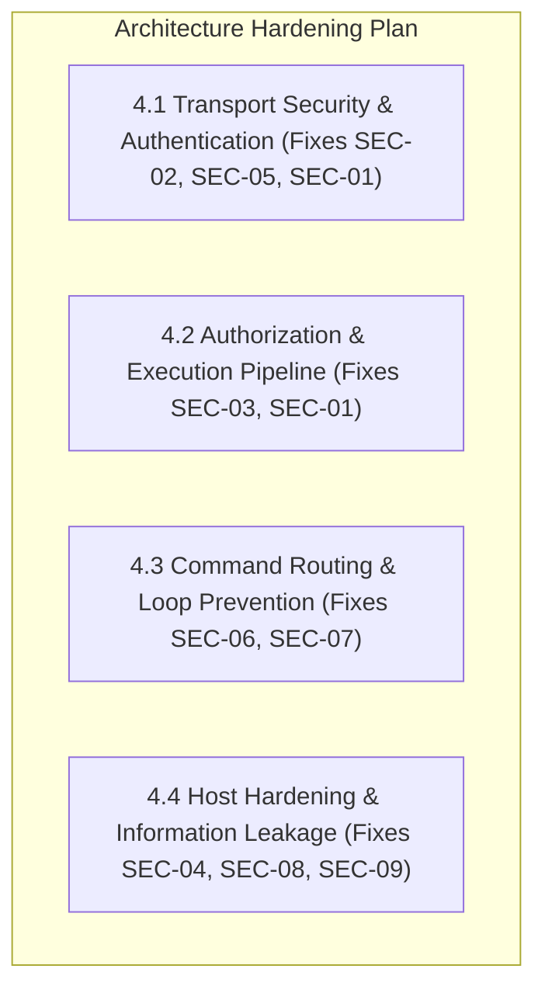
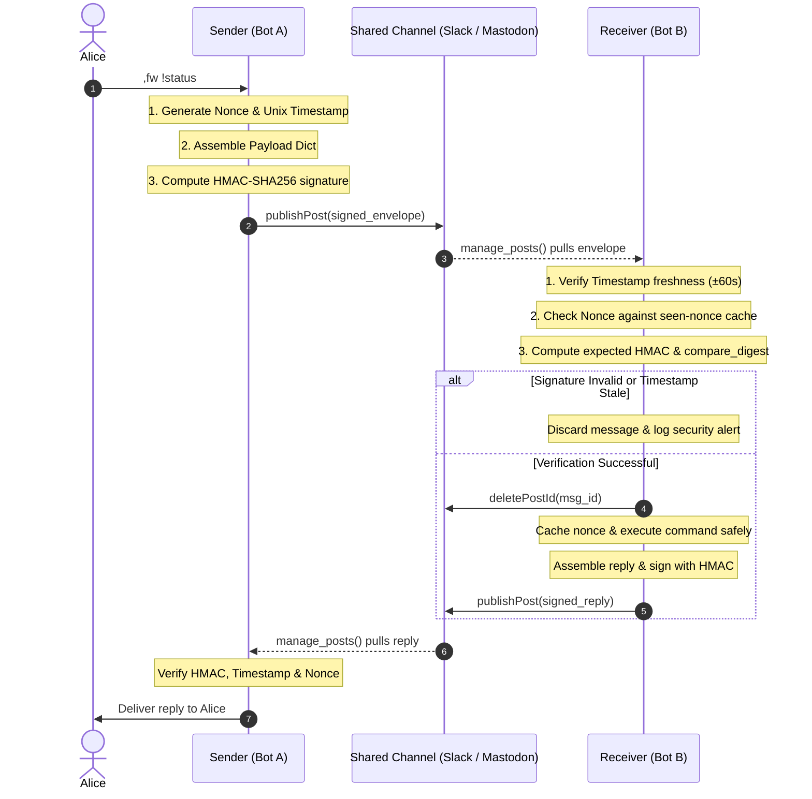
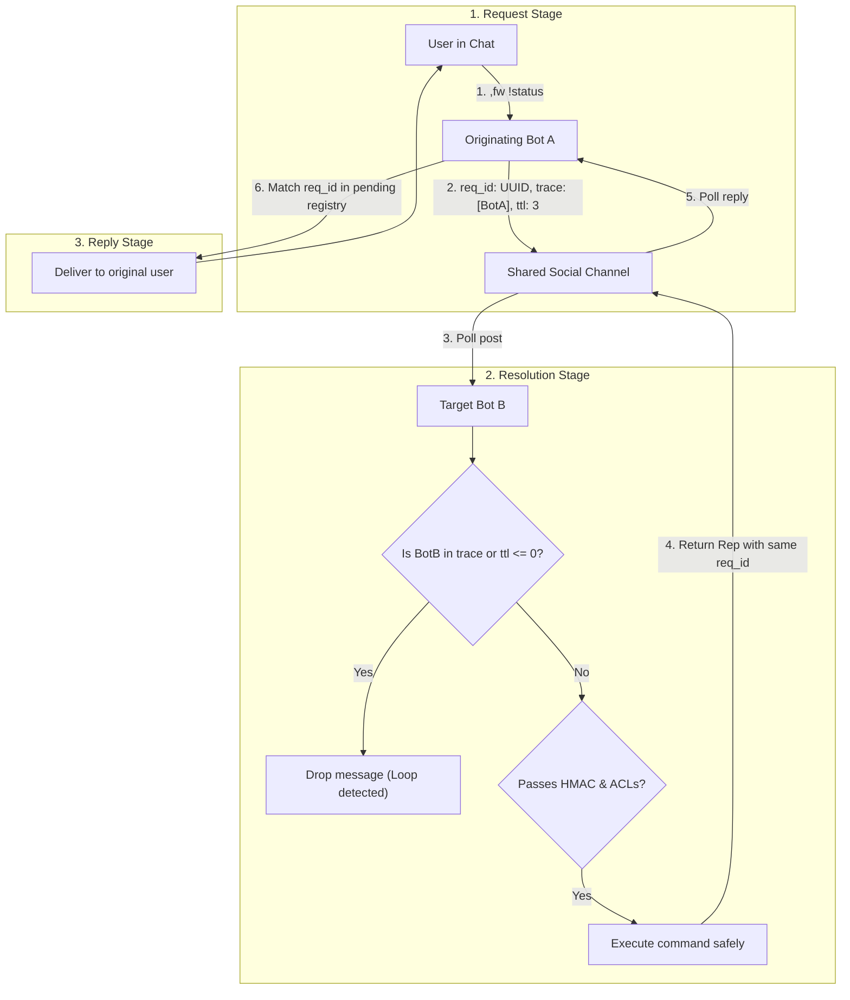

# errForward.py. Security Analysis and Architecture Review of:


## 1. Executive Summary & Threat Model

`errForward.py` is an Errbot plugin that bridges local Errbot instances with shared external messaging channels (such as Slack, Gitter, Mastodon, or Twitter) to forward commands and replies between bots and users.

### Operational Context vs. Security Boundary
The plugin was originally designed as a **single-user personal information manager**, where a single owner operates multiple distributed bot nodes across different networks (home server, office workstation, VPS). In this single-user operational model, the communication channel was assumed to be private, and commands forwarded across nodes were treated as originating from the owner.

However, when deployed in multi-user chat channels, public feeds (e.g. Mastodon/Twitter), or shared teams:
1. The external communication channel is an **untrusted multi-user medium**.
2. Assumptions of caller authenticity and transport privacy break down.
3. The lack of cryptographic verification, automatic fallbacks to administrator privileges, and direct execution of plugin methods create **critical vulnerabilities**, including unauthenticated Remote Command Execution (RCE) and complete access control bypass.

---

## 2. Vulnerability Assessment Matrix

| Severity | ID | Vulnerability Summary | Lines | Remediation |
| :--- | :--- | :--- | :--- | :--- |
| **Critical** | SEC-01 | Admin Privilege Escalation via Fallback & Identity Spoofing | [L322–L332](file:///home/ftricas/usr/src/Python/deGitHub/err-forward/errForward.py#L322-L332) | Sec. 4.1 & 4.2 |
| **Critical** | SEC-02 | Unauthenticated Remote Command Execution (RCE) via Shared Channel | [L280–L374](file:///home/ftricas/usr/src/Python/deGitHub/err-forward/errForward.py#L280-L374) | Sec. 4.1 |
| **Critical** | SEC-03 | Complete Bypass of Errbot ACLs and Middleware Pipeline | [L317–L337](file:///home/ftricas/usr/src/Python/deGitHub/err-forward/errForward.py#L317-L337) | Sec. 4.2 |
| **High** | SEC-04 | Host Reconnaissance & Sensitive Information Disclosure | [L80–L88](file:///home/ftricas/usr/src/Python/deGitHub/err-forward/errForward.py#L80-L88), [L137–L162](file:///home/ftricas/usr/src/Python/deGitHub/err-forward/errForward.py#L137-L162) | Sec. 4.4 |
| **High** | SEC-05 | Lack of Message Integrity, Authenticity & Replay Protection | [L207–L215](file:///home/ftricas/usr/src/Python/deGitHub/err-forward/errForward.py#L207-L215) | Sec. 4.1 |
| **Medium** | SEC-06 | Arbitrary Reply Redirection & Data Exfiltration | [L400–L415](file:///home/ftricas/usr/src/Python/deGitHub/err-forward/errForward.py#L400-L415) | Sec. 4.3 |
| **Medium** | SEC-07 | Denial of Service via Cascading Forwarding Loops | [L245–L278](file:///home/ftricas/usr/src/Python/deGitHub/err-forward/errForward.py#L245-L278), [L464–L475](file:///home/ftricas/usr/src/Python/deGitHub/err-forward/errForward.py#L464-L475) | Sec. 4.3 |
| **Medium** | SEC-08 | Insecure Dynamic Module Import | [L49–L71](file:///home/ftricas/usr/src/Python/deGitHub/err-forward/errForward.py#L49-L71) | Sec. 4.4 |
| **Low** | SEC-09 | Audit Log Evasion via Immediate Message Deletion | [L291–L295](file:///home/ftricas/usr/src/Python/deGitHub/err-forward/errForward.py#L291-L295), [L389–L396](file:///home/ftricas/usr/src/Python/deGitHub/err-forward/errForward.py#L389-L396) | Sec. 4.4 |

---

## 3. In-Depth Vulnerability Analysis

### SEC-01: Admin Privilege Escalation via Fallback & Identity Spoofing (Critical)

- **Affected Lines:** [errForward.py#L322-L332](file:///home/ftricas/usr/src/Python/deGitHub/err-forward/errForward.py#L322-L332)
- **Description:**
  In `manage_command()`, the command sender identity (`sender`) is extracted from the incoming JSON payload:
  ```python
  sender_str = msg_e.get('frm')
  if sender_str and sender_str != '-':
      try:
          sender = self._bot.build_identifier(sender_str)
      except Exception:
          sender = None
  elif getattr(self._bot.bot_config, 'BOT_ADMINS', None):
      sender = self._bot.build_identifier(self._bot.bot_config.BOT_ADMINS[0])
  else:
      sender = None
  ```
- **Security Impact:**
  1. **Automatic Admin Elevation:** If `frm` is missing, blank, or set to `"-"`, the sender automatically defaults to `BOT_ADMINS[0]`. Any unauthenticated payload posted to the channel executes with full administrator privileges.
  2. **Sender Spoofing:** Because payloads are not signed, an attacker can specify any administrator identifier in `frm` (`"frm": "@admin:slack"`), tricking plugins into trusting the caller.
- **Root Cause & Design Context:**
  This fallback was introduced to solve practical operational constraints:
  - *Cross-backend identifier resolution:* Foreign identifiers from Slack or Matrix cannot be resolved by an IRC or XMPP backend without failing.
  - *Preventing plugin crashes:* Errbot plugins expect `mess.frm` to be a valid `Identifier`. Passing `None` causes unhandled `AttributeError` crashes in plugins.
  - *Dead-letter delivery:* In `manage_reply()`, sending unroutable replies to `BOT_ADMINS[0]` ensured command outputs were not silently lost.

---

### SEC-02: Unauthenticated Remote Command Execution (RCE) via Shared Channel (Critical)

- **Affected Lines:** [errForward.py#L280-L374](file:///home/ftricas/usr/src/Python/deGitHub/err-forward/errForward.py#L280-L374), [errForward.py#L419-L446](file:///home/ftricas/usr/src/Python/deGitHub/err-forward/errForward.py#L419-L446)
- **Description:**
  `manage_posts()` polls messages from the configured channel without verifying message authenticity, tokens, or digital signatures.
- **Security Impact:**
  Any user with posting access to the channel (or any public user if using a public timeline on Mastodon or Twitter) can post a command JSON message and execute commands on the bot host. Combined with plugins that interact with the host operating system, filesystem, or shell, this yields unauthenticated Remote Code Execution.

---

### SEC-03: Complete Bypass of Errbot ACLs and Middleware Pipeline (Critical)

- **Affected Lines:** [errForward.py#L317-L337](file:///home/ftricas/usr/src/Python/deGitHub/err-forward/errForward.py#L317-L337)
- **Description:**
  Commands are looked up directly from `self._bot.all_commands` and called as raw Python functions:
  ```python
  if effective_cmd in list_commands:
      method = list_commands[effective_cmd]
      ...
      replies = method(new_msg, new_args)
  ```
- **Security Impact:**
  Direct invocation completely bypasses Errbot's security middleware:
  - Access Control Lists (`ACCESS_CONTROLS` in `config.py`) that restrict commands by user, room, or arguments.
  - Command filter hooks (`@cmdfilter`) and decorators.
  - Administrator checks (`@botcmd(admin_only=True)`).
  - Custom argument splitters (`split_args_with` / `argparse`).
- **Root Cause:**
  Errbot's native command execution engine sends replies directly to the local backend using `self.send_simple_reply(msg, text)`. Because `errForward` needs to capture the output string to package it into a JSON envelope (`typ: 'Rep'`) and publish it back to the external channel, it bypassed the engine and called `method()` directly.

---

### SEC-04: Host Reconnaissance & Sensitive Information Disclosure (High)

- **Affected Lines:** [errForward.py#L80-L88](file:///home/ftricas/usr/src/Python/deGitHub/err-forward/errForward.py#L80-L88), [errForward.py#L137-L162](file:///home/ftricas/usr/src/Python/deGitHub/err-forward/errForward.py#L137-L162)
- **Description:**
  - On activation, the bot broadcasts internal environment details to the shared channel:
    ```python
    f"Hello! IP: {self.get_my_ip()}. Commands [{bot_prefix}]. Name: {self.user_name}@{self.user_host}. Backend: {backend}"
    ```
  - The `!myip` and `!myIP` bot commands can be invoked by any user to determine the outbound egress IP of the host:
    ```python
    @botcmd
    def myip(self, mess, args):
        """IP of the bot"""
        yield self.get_my_ip()
    ```
- **Security Impact:**
  Exposes internal network details, egress IP addresses, system account usernames (`os.getuid()`), internal hostnames (`os.uname()`), and bot backend types. This information provides adversaries with precise target profiling and network mapping data.
- **Root Cause & Operational Context:**
  This broadcast was implemented for two administrative purposes:
  1. *Peer Prefix Discovery:* The broadcast mechanism ([broadcast_command](file:///home/ftricas/usr/src/Python/deGitHub/err-forward/errForward.py#L245-L278)) relies on scanning channel history with `sc.getBots(chan)` for `Commands [{prefix}]` to discover connected peer bots.
  2. *Dynamic Node Tracking:* For nodes running on dynamic residential broadband or unmanaged VPS instances, the announcement and `!myip` command allowed the owner to quickly identify newly booted machines and their external IP addresses.

---

### SEC-05: Lack of Message Integrity, Authenticity & Replay Protection (High)

- **Affected Lines:** [errForward.py#L207-L215](file:///home/ftricas/usr/src/Python/deGitHub/err-forward/errForward.py#L207-L215), [errForward.py#L220-L243](file:///home/ftricas/usr/src/Python/deGitHub/err-forward/errForward.py#L220-L243)
- **Description:**
  Messages are formatted as raw, unsigned JSON strings without cryptographic signatures, nonces, or timestamps:
  ```python
  msg = {
      'userName': usr or self.user_name or pwd.getpwuid(os.getuid())[0],
      'userHost': host or self.user_host or os.uname()[1],
      'frm': str(frm) if frm else '',
      'typ': typ,
      'cmd': cmd,
      'args': args,
  }
  ```
  The system relies exclusively on platform post deletion (`self.sc.deletePostId(msg[self.id_post])`) as a crude queue management mechanism.
- **Security Impact & Failure Modes:**
  1. *Infinite Command Re-execution on Deletion Failure:* If post deletion fails (e.g. API rate limits, temporary network errors, lack of channel delete permissions, or read-only/federated platforms like Mastodon/Twitter where deleting other users' posts is prohibited), the 60-second poller continuously re-reads and **re-executes the command indefinitely**.
  2. *Message Tampering in Transit:* Without cryptographic integrity, anyone with channel access can intercept and modify command names (`cmd`) or parameters (`args`) before the target bot processes them.
  3. *Replay Attacks:* Valid captured command payloads can be reposted to the channel by unauthorized actors to trigger repeated command execution.
- **Root Cause & Operational Context:**
  In a private channel used solely by one person, post deletion seemed sufficient to prevent re-execution. However, treating a social channel as a message queue without message deduplication or cryptographic signatures breaks down under real-world network conditions.

---

### SEC-06: Arbitrary Reply Redirection & Data Exfiltration (Medium)

- **Affected Lines:** [errForward.py#L400-L415](file:///home/ftricas/usr/src/Python/deGitHub/err-forward/errForward.py#L400-L415)
- **Description:**
  In `manage_reply()`, destination identifiers are derived from the unverified `frm` property of the incoming JSON reply:
  ```python
  frm = msg_e.get('frm')
  if frm and frm != '-':
      try:
          msg_to = self._bot.build_identifier(frm)
      except Exception:
          msg_to = None
  elif getattr(self._bot.bot_config, 'BOT_ADMINS', None):
      msg_to = self._bot.build_identifier(self._bot.bot_config.BOT_ADMINS[0])
  ...
  self.send(msg_to, replies)
  ```
- **Security Impact & Failure Modes:**
  1. *Data Exfiltration / Output Interception:* Because `frm` is carried inside an unauthenticated message payload, an attacker can forward a command with their own identifier in `frm` (e.g. `"frm": "@attacker:slack"` or `"frm": "attacker@jabber.org"`). When the target bot processes the command, the output (which may contain internal network data, plugin status, or configuration details) is sent directly to the attacker.
  2. *Administrator Notification Flooding (DoS):* If `frm` is omitted or set to `"-"`, every reply is automatically delivered to `BOT_ADMINS[0]`. An attacker posting high-volume commands can flood the administrator's private chat.
  3. *Bot as an Unwitting Messaging Proxy:* An adversary on the external channel can forge `Rep` messages with `frm` set to any victim user on the bot's chat network, turning the bot into a spam or harassment relay.
- **Root Cause & Operational Context:**
  When a user issues `,forward !status`, the originating bot records their chat ID in `frm` so that the target bot can return the response. If the original requester was missing or disconnected, routing to `BOT_ADMINS[0]` was intended as a catch-all to ensure command outputs were not silently lost.

---

### SEC-07: Denial of Service via Cascading Forwarding Loops (Medium)

- **Affected Lines:** [errForward.py#L245-L278](file:///home/ftricas/usr/src/Python/deGitHub/err-forward/errForward.py#L245-L278), [errForward.py#L464-L475](file:///home/ftricas/usr/src/Python/deGitHub/err-forward/errForward.py#L464-L475)
- **Description:**
  The plugin supports broadcast execution (`*command`) and chained forwarding (`!fw !fw ...`) without tracking hop counts (TTL) or visited nodes:
  ```python
  if cmd.startswith('*'):
      new_cmd = cmd[1:]
      msg = {'mess': mess, 'typ': 'Cmd', 'cmd': new_cmd, 'args': new_args}
      self.broadcast_command(msg, new_cmd)
  ```
- **Security Impact & Failure Modes:**
  1. *Infinite Forwarding Storms:* Because messages carry no hop limits or visited-node history, circular routing loops easily occur (e.g. Bot A forwards to Bot B, which broadcasts back to Bot A).
  2. *API Rate-Limit Lockout:* Social messaging APIs enforce strict rate limits (e.g., Slack limits chat posting to ~1 msg/sec per channel; Mastodon limits to ~300 requests/5 minutes). A forwarding loop quickly burns API quotas, causing HTTP 429 errors that take the bot offline.
  3. *Thread & Memory Starvation:* Continuous post creation and deletion overwhelms the 60-second poller thread and exhausts Errbot's internal queues.
- **Root Cause & Operational Context:**
  Chained forwarding was implemented to allow reaching isolated or downstream bots through gateway nodes, while broadcast execution was designed for quick cluster-wide status queries.

---

### SEC-08: Insecure Dynamic Module Import (Medium)

- **Affected Lines:** [errForward.py#L49-L71](file:///home/ftricas/usr/src/Python/deGitHub/err-forward/errForward.py#L49-L71)
- **Description:**
  `my_module = self.config.get('module', 'moduleSlack')` is concatenated directly into `importlib.import_module(f"socialModules.{my_module}")` without checking an explicit whitelist:
  ```python
  my_soc_module = f"socialModules.{my_module}"
  mod = importlib.import_module(my_soc_module)
  cls = getattr(mod, my_module)
  site = cls()
  ```
- **Security Impact & Failure Modes:**
  1. *Arbitrary Module Loading:* If bot configuration is modified (via Errbot configuration commands, config injection, or database manipulation), setting `module` to an arbitrary package name causes `importlib.import_module()` to execute top-level code of unintended modules on the host.
  2. *Lack of Interface Verification:* `getattr(mod, my_module)()` instantiates any callable matching the string name, which can lead to unexpected attribute exceptions or runtime instability.
- **Root Cause & Operational Context:**
  This dynamic loader was implemented for modularity, allowing users to configure whether the bot connects to Slack, Gitter, Mastodon, or Twitter dynamically without code changes.

---

### SEC-09: Audit Log Evasion via Immediate Message Deletion (Low)

- **Affected Lines:** [errForward.py#L291-L295](file:///home/ftricas/usr/src/Python/deGitHub/err-forward/errForward.py#L291-L295), [errForward.py#L389-L396](file:///home/ftricas/usr/src/Python/deGitHub/err-forward/errForward.py#L389-L396)
- **Description:**
  Incoming command and reply messages are deleted immediately after receipt (`self.sc.deletePostId(...)`).
- **Security Impact:**
  While intended to keep the channel clean, this destroys forensic records on the chat platform, making post-incident investigation difficult. If an attacker exploits any of the above vulnerabilities, the evidence of their commands is automatically removed by the bot itself.
- **Root Cause & Operational Context:**
  In the original personal bot mesh, the channel was used purely as a transient transport queue (similar to a message broker). Deleting processed messages prevented the poller from re-executing them (the sole deduplication mechanism before nonce-based replay protection). Keeping the channel tidy also avoided visual clutter for the single owner.

---

## 4. Comprehensive Remediation & Architecture Blueprint

To address the findings systematically, the remediations are organized into four architectural domains:



---

### 4.1 Message Transport & Authentication
*(Remediates SEC-02, SEC-05, and identity spoofing in SEC-01)*

All communication across the external channel must transition from plaintext JSON to an **HMAC-authenticated signed envelope** with timestamp freshness and nonce replay protection.

#### Protocol Sequence



#### Signed Envelope Structure
```json
{
  "ver": 1,
  "ts": 1700000000,
  "nonce": "e3b0c44298fc1c149afbf4c8996fb92427ae41e4649b934ca495991b7852b855",
  "payload": {
    "userName": "ftricas",
    "userHost": "laptop",
    "frm": "@alice:matrix.org",
    "typ": "Cmd",
    "cmd": "!status",
    "args": "",
    "req_id": "a1b2c3d4e5f6...",
    "trace": ["bot-slack-home"],
    "ttl": 3
  },
  "sig": "f4b2a8d3e861d8a4e98... (HMAC-SHA256 hex string)"
}
```

#### Implementation Blueprint (Sender Signing & Receiver Verification)
```python
import hashlib
import hmac
import json
import time
import uuid

def sign_payload(payload_dict, key):
    ts = int(time.time())
    nonce = uuid.uuid4().hex
    canonical_payload = json.dumps(payload_dict, sort_keys=True)
    sign_data = f"{ts}:{nonce}:{canonical_payload}".encode('utf-8')
    sig = hmac.new(key.encode('utf-8'), sign_data, hashlib.sha256).hexdigest()
    
    envelope = {
        'ver': 1,
        'ts': ts,
        'nonce': nonce,
        'payload': payload_dict,
        'sig': sig,
    }
    return json.dumps(envelope)

def verify_message(envelope, key, seen_nonces, window=60):
    is_valid = False
    if key and isinstance(envelope, dict):
        ts = envelope.get('ts', 0)
        nonce = envelope.get('nonce', '')
        sig = envelope.get('sig', '')
        payload = envelope.get('payload', {})
        now = int(time.time())
        
        # 1. Freshness check & Replay prevention
        if abs(now - ts) <= window and nonce not in seen_nonces:
            # 2. Canonical recalculation
            canonical_payload = json.dumps(payload, sort_keys=True)
            sign_data = f"{ts}:{nonce}:{canonical_payload}".encode('utf-8')
            expected_sig = hmac.new(
                key.encode('utf-8'), sign_data, hashlib.sha256
            ).hexdigest()
            
            # 3. Constant-time digest comparison
            if hmac.compare_digest(sig, expected_sig):
                seen_nonces.add(nonce)
                is_valid = True
    return is_valid
```

---

### 4.2 Authorization & Execution Pipeline
*(Remediates SEC-03 and admin fallback in SEC-01)*

To enforce Errbot's security boundaries without breaking output interception, incoming commands must be filtered through Errbot's middleware and checked against an explicit command policy.

#### Step 1: Eliminate Admin Fallback & Use Safe Proxy Identity
Never default to `BOT_ADMINS[0]`. If `frm` is missing or unresolvable across backends, build a dedicated unprivileged proxy identifier:
```python
sender_str = msg_e.get('frm')
if sender_str and sender_str != '-':
    try:
        sender = self._bot.build_identifier(sender_str)
    except Exception:
        sender = self._bot.build_identifier("remote_guest@forwarder")
else:
    sender = self._bot.build_identifier("remote_guest@forwarder")
```
This ensures `new_msg.frm` is never `None` (preventing plugin crashes) while guaranteeing that unauthenticated callers possess zero administrator privileges.

#### Step 2: Enforce Errbot's Filter Pipeline (`_process_command_filters`)
Before calling `method()`, evaluate Errbot's command filters. This automatically applies `ACCESS_CONTROLS`, user allow/deny lists, room rules, and `@botcmd(admin_only=True)`:
```python
filtered_msg, filtered_cmd, filtered_args = self._bot._process_command_filters(
    new_msg, effective_cmd, new_args, dry_run=False
)

if filtered_msg is None:
    self.log.warning(
        f"Command '{effective_cmd}' blocked by ACLs or filters for sender {new_msg.frm}"
    )
    reply_msg = self.prepare_message(
        typ='Rep',
        usr=msg_e.get('userName', ''),
        host=msg_e.get('userHost', ''),
        frm=msg_e.get('frm', ''),
        cmd=effective_cmd,
        args="Access denied: You are not authorized to run this command.",
    )
    self.sc.publishPost(reply_msg, '', self._get_channel())
    return

new_msg, effective_cmd, new_args = filtered_msg, filtered_cmd, filtered_args
replies = method(new_msg, new_args)
```

#### Step 3: Defense-in-Depth Forwarding Whitelist
Add configuration settings to restrict which commands may be forwarded over the bridge:
```python
import fnmatch

def is_command_permitted(self, cmd_name):
    allowed = self._check_config('allowed_commands') or ['status', 'uptime', 'help', 'info']
    denied = self._check_config('denied_commands') or ['plugin_*', 'config', 'shutdown', 'restart', 'backup']

    for pattern in denied:
        if fnmatch.fnmatch(cmd_name, pattern):
            return False

    if allowed:
        return any(fnmatch.fnmatch(cmd_name, pattern) for pattern in allowed)

    return True
```

---

### 4.3 Command Routing & Loop Prevention
*(Remediates SEC-06, SEC-07, and routing limitations)*



#### Correlation IDs (`req_id`) & Safe Reply Dispatch
Replace OS-level `(userName, userHost)` fingerprinting and unverified wire `frm` routing with a local request registry:

```python
# 1. On Initiator (in forward_command):
req_id = uuid.uuid4().hex
self.pending_requests[req_id] = {
    'recipient': mess.frm,
    'created_at': time.time(),
}

# 2. On Target (in manage_command):
# Echo the incoming req_id in the reply payload
reply_msg = self.prepare_message(
    typ='Rep',
    req_id=msg_e.get('req_id'),
    args=chunk,
)

# 3. On Initiator receiving Rep (in manage_reply):
req_id = msg_e.get('req_id')
request_data = self.pending_requests.pop(req_id, None)

if request_data:
    msg_to = request_data['recipient']
    self.send(msg_to, replies)
else:
    self.log.warning(f"Discarding unmatched or expired reply with req_id: {req_id}")
    # CRITICAL: Never fall back to BOT_ADMINS[0]
```

#### Loop Prevention via Trace Vector & TTL
Every forwarded payload carries a hop counter (`ttl`) and a visited bot trace list (`trace`):

```python
# In manage_command before processing:
trace = msg_e.get('trace', [])
ttl = msg_e.get('ttl', 3)

# Check for forwarding loops or hop exhaustion
if self.bot_identifier in trace or ttl <= 0:
    self.log.warning(
        f"Dropping forwarded command: loop detected (bot in trace) or TTL exhausted ({ttl})"
    )
    return

# When forwarding downstream (e.g. chained forward):
downstream_trace = trace + [self.bot_identifier]
downstream_ttl = ttl - 1
```

#### User-Facing Error Reporting
Instead of silently logging exceptions when command execution fails, return a diagnostic error reply:
```python
except Exception as e:
    self.log.exception(f"Error executing command: {e}")
    error_reply = self.prepare_message(
        typ='Rep',
        req_id=msg_e.get('req_id'),
        args=f"Error executing `{effective_cmd}`: {e}",
    )
    self.sc.publishPost(error_reply, '', chan_p)
```

---

### 4.4 Host Hardening & Information Leakage
*(Remediates SEC-04, SEC-08, SEC-09)*

#### 1. Sanitize Startup Announcements & Decouple Peer Discovery
Modify the startup activation post in `activate()` to remove sensitive operating system usernames, hostnames, and IP addresses while preserving prefix discovery for `broadcast_command`:

```python
# Sanitized startup announcement (preserves peer prefix discovery)
bot_prefix = getattr(self._bot.bot_config, 'BOT_PREFIX', '!')
bot_identifier = self.config.get('user_name') or 'errbot'

# Only include IP if explicitly enabled in configuration
ip_info = f" IP: {self.get_my_ip()}." if self.config.get('announce_ip', False) else ""

msg_j = self.prepare_message(
    typ='Msg',
    args=f"Bot '{bot_identifier}' online.{ip_info} Commands [{bot_prefix}]."
)
self.sc.publishPost(msg_j, '', chan)
```

#### 2. Restrict Diagnostic IP Commands to Administrators
Decorate `myip` and `myIP` in [errForward.py#L149-L162](file:///home/ftricas/usr/src/Python/deGitHub/err-forward/errForward.py#L149-L162) with `admin_only=True` to prevent unauthenticated network reconnaissance:

```python
@botcmd(admin_only=True)
def myip(self, mess, args):
    """IP of the bot (restricted to bot administrators)"""
    yield self.get_my_ip()

@botcmd(admin_only=True)
def myIP(self, mess, args):
    """IP of the bot (legacy alias, restricted to bot administrators)"""
    yield self.get_my_ip()
```

#### 3. Whitelist Dynamic Social Modules
In `activate()`, enforce a strict whitelist before calling `importlib.import_module()`:

```python
ALLOWED_SOCIAL_MODULES = {
    'moduleSlack',
    'moduleGitter',
    'moduleMastodon',
    'moduleTwitter',
}

my_module = self.config.get('module', 'moduleSlack')
if my_module not in ALLOWED_SOCIAL_MODULES:
    self.log.error(f"Refusing to load unauthorized module: {my_module}")
    return
```

#### 4. Preserve Forensic Logs
Rather than immediately executing `self.sc.deletePostId()` upon receipt, log all processed commands and replies to the bot's local log before deletion. This preserves an audit trail even after the channel post is removed:

```python
# In manage_command, before deleting the post:
self.log.info(
    f"AUDIT: Received forwarded command '{msg_e.get('cmd')}' "
    f"from '{msg_e.get('frm', 'unknown')}' "
    f"with args '{msg_e.get('args', '')}' "
    f"[req_id={msg_e.get('req_id', 'none')}]"
)

# In manage_reply, before deleting the post:
self.log.info(
    f"AUDIT: Received reply for cmd '{msg_e.get('cmd')}' "
    f"destined for '{msg_e.get('frm', 'unknown')}' "
    f"[req_id={msg_e.get('req_id', 'none')}]"
)

# Then proceed with deletion
if self.id_post in msg:
    self.sc.deletePostId(msg[self.id_post])
```

---

## 5. Prioritized Remediation Roadmap

### Phase 1: Immediate Critical Fixes (Deploy Immediately)
- [ ] Remove fallback to `BOT_ADMINS[0]` in [L328–L330](file:///home/ftricas/usr/src/Python/deGitHub/err-forward/errForward.py#L328-L330); replace with `remote_guest@forwarder`.
- [ ] Insert `_process_command_filters()` check in [L317](file:///home/ftricas/usr/src/Python/deGitHub/err-forward/errForward.py#L317) to enforce Errbot ACLs.
- [ ] Remove IP, OS username, and hostname from startup announcement in [L80–L88](file:///home/ftricas/usr/src/Python/deGitHub/err-forward/errForward.py#L80-L88).
- [ ] Restrict `!myip` to `admin_only=True`.
- [ ] Add `ALLOWED_SOCIAL_MODULES` whitelist in `activate()` before `importlib.import_module()`.
- [ ] Add audit logging before `deletePostId()` calls in `manage_command` and `manage_reply`.

### Phase 2: Transport & Cryptographic Security (Next Release)
- [ ] Implement the HMAC signed envelope (`sign_payload` and `verify_message`).
- [ ] Add `hmac_key` and `replay_window_sec` to the plugin configuration template.
- [ ] Introduce the sliding-window nonce cache to block replay attacks.
- [ ] Add `allowed_commands` / `denied_commands` to the configuration template.

### Phase 3: Routing Architecture Modernization (Stable Architecture)
- [ ] Migrate request/reply matching from OS username/hostname to UUID correlation IDs (`req_id`).
- [ ] Add `trace` vector and `ttl` to eliminate infinite forwarding loops.
- [ ] Implement caller error reporting for failed remote commands.
- [ ] Add interface assertion for dynamically loaded social modules (verify `publishPost`, `getPosts`, `deletePostId`, `setChannel` methods exist).

---

## 6. Change Log Since the Analysis Baseline & Security Delta

**Baseline:** Sections 1–5 of this document were written against commit `51f59c4` (2026-11-13, *"Fix double-forward bug, improve robustness and add test suite"*), on branch `devel`. This section records the changes made after that baseline, assesses their security impact, and adds two findings that did not exist when the review was performed.

### 6.1 Recent Change History (2026-11-13 → 2026-11-17)

| Commit | Date | Change | Security Relevance |
| :--- | :--- | :--- | :--- |
| `51f59c4` | 2026-11-13 | Double-forward crash fixed: `new_msg` is now always a valid `Message`; added `_get_channel()`, `check_configuration()`, safe `get_my_ip()`; removed debug `end()`; fixed Python 3.12 escape warning; added `tests/test_err_forward.py`. | **Baseline.** Increases exposure — see Sec. 6.2. |
| `c034362` | 2026-11-13 | README: fenced snippets, added the full configuration table (`channel`, `module`, `id_post_override`, `user_name`, `user_host`). | Neutral (documentation only). |
| `9cf125e` | 2026-11-13 | `manage_reply()` also accepts replies addressed to the legacy target `<bot_id>@err-forward`, in addition to `<user_name>@<user_host>`; added `test_manage_reply_accepts_legacy_bot_id_target`. | **Negative** — introduces **SEC-10**. |
| `35fdc59` | 2026-11-16 | Commented out the legacy alias `listB = list_bots_cmd`, which collided with the `@botcmd(name='listB')` decorator and made Errbot fail at startup. | Neutral. `listB` remains exposed and unauthenticated (**SEC-04** still open). |
| `1b1e754` | 2026-11-16 | Every publish now calls `self.sc.setChannel(chan)` immediately before `publishPost(..., '', '')`, because older `socialModules` backends ignored the channel argument. Applied at the activation message, peer broadcast, command reply chunks, and forward. | **Negative** — introduces **SEC-11**. |
| `f508994` | 2026-11-17 | `manage_command()` now reproduces Errbot's `split_args_with` argument conversion before invoking a forwarded command, fixing `Unknown plugin or the plugin could not load E.` for `.fw =plugin config ErrForward`; added a regression test. | **Positive functional correction.** Partially reduces the argument-dispatch gap described in **SEC-03**, but does not restore Errbot ACLs, admin checks, or command filters. |

At the time of this update, `analysis.md`/`analysis.pdf`, this document and its PDF, `pandoc.sh`, and a stray `.errForward.py.swp` editor swap file remain untracked documentation or workspace artifacts. The code change in `f508994` was committed and pushed; **no code change has yet been made in response to any security finding in Sections 2–5.**

### 6.2 Exposure Increased by the Baseline Fix

The pre-`51f59c4` code built the dispatched `Message` only in the no-arguments branch:

```python
# Pre-fix behaviour in manage_command()
if unquoted_args:
    new_args = unquoted_args
    new_msg = ""              # <-- not a Message object
else:
    new_msg = Message(frm=self._bot.build_identifier(
        self.bot_config.BOT_ADMINS[0]))
    new_args = ""
replies = method(new_msg, new_args)
```

Two consequences matter for this review:

1. **The crash was an accidental barrier.** Any forwarded command carrying arguments was invoked with `""` as its `mess`, so methods touching `mess.frm` raised `AttributeError`, which the surrounding `except` swallowed. Those commands silently did not run. After the fix they execute correctly — so the unauthenticated execution paths described in **SEC-02** and **SEC-03** are now *fully reachable with arguments* rather than being incidentally blocked by a bug. Chained forwarding (`,fw !fw *status`) is now a working amplification path for **SEC-07**.
2. **Attacker-supplied identity became authoritative.** The fix also changed *where* the sender comes from: it was previously hardcoded to `BOT_ADMINS[0]`, and is now taken from the payload's `frm` field ([L324–L332](file:///home/ftricas/usr/src/Python/deGitHub/err-forward/errForward.py#L324-L332)). This is the correct direction for correctness but it is precisely what makes the **spoofing** half of **SEC-01** exploitable — an unsigned `frm` naming any local identifier is now trusted. The admin fallback still applies whenever `frm` is absent, `-`, or unresolvable.

> The functional fix is sound and should not be reverted. It raises the priority of the Phase 1 and Phase 2 remediations, because the plugin now does what it was always meant to do — on an untrusted transport.

### 6.3 SEC-10: Unsolicited Message Injection via Legacy Reply Target (High)

- **Affected Lines:** [errForward.py#L388-L399](file:///home/ftricas/usr/src/Python/deGitHub/err-forward/errForward.py#L388-L399), [errForward.py#L413-L428](file:///home/ftricas/usr/src/Python/deGitHub/err-forward/errForward.py#L413-L428)
- **Introduced By:** `9cf125e` (after the baseline review).
- **Description:**
  `manage_reply()` decides whether a `Rep` payload is "for me" by matching the embedded `userName`/`userHost`. Commit `9cf125e` added a second, always-enabled acceptance rule:
  ```python
  legacy_bot_id = self.config.get('bot_id', 'bot1') if self.config else 'bot1'
  is_legacy_target = (
      target_name == legacy_bot_id and target_host == 'err-forward'
  )
  if is_current_target or is_legacy_target:
      ...
      if msg_to and replies:
          self.send(msg_to, replies)
  ```
  Both `msg_to` (from the payload's `frm`) and `replies` (from the payload's `args`) are attacker-controlled, and neither the payload nor the target is authenticated.
- **Security Impact:**
  1. **Message injection / phishing:** anyone able to post to the shared channel can make the bot send arbitrary text to any identifier the local backend can resolve, and the message appears to come from the trusted local bot. No forwarded command is required — a single crafted `Rep` post is enough.
  2. **Guessable default:** when `bot_id` is unset the legacy name defaults to `'bot1'` and the host is the constant `'err-forward'`, so the accepted target is publicly known rather than deployment-specific.
  3. **Permanently widened surface:** the legacy rule is unconditional. Older peers are not detected or negotiated with, so installations that never used the legacy convention still accept it.
  4. Compounds **SEC-06** (reply redirection) and **SEC-05** (no integrity or replay protection); the same payload replayed produces repeated unsolicited messages.
- **Remediation:**
  - Gate the legacy rule behind an explicit opt-in configuration key (e.g. `accept_legacy_target: false` by default) and remove the hardcoded `'bot1'`/`'err-forward'` defaults.
  - Only honour a `Rep` whose `cmd`/`req_id` matches an outstanding request this bot actually issued (see Sec. 4.3, *Correlation IDs*). An unmatched reply must be dropped and logged.
  - Long term, the signed envelope of Sec. 4.1 makes the whole class of injected-payload findings unexploitable.

### 6.4 SEC-11: Unsynchronized Channel State Across Threads (TOCTOU) (Medium)

- **Affected Lines:** [errForward.py#L92](file:///home/ftricas/usr/src/Python/deGitHub/err-forward/errForward.py#L92), [L275](file:///home/ftricas/usr/src/Python/deGitHub/err-forward/errForward.py#L275), [L371](file:///home/ftricas/usr/src/Python/deGitHub/err-forward/errForward.py#L371), [L495](file:///home/ftricas/usr/src/Python/deGitHub/err-forward/errForward.py#L495); poller at [L97](file:///home/ftricas/usr/src/Python/deGitHub/err-forward/errForward.py#L97)
- **Introduced By:** `1b1e754` (after the baseline review).
- **Description:**
  Publishing now depends on mutable state held by the shared social-module instance:
  ```python
  self.sc.setChannel(chan)
  self.sc.publishPost(msg_j, '', '')
  ```
  `manage_posts()` runs on Errbot's poller thread (`self.start_poller(60, self.manage_posts)`), while `forward_command()` and the peer broadcast run on the backend's callback thread. Nothing serializes the `setChannel()` → `publishPost()` pair, so an interleaving between the two calls changes the destination of the message. The code elsewhere already acknowledges that this state is transient — `manage_reply()` saves and restores it around the deletion ([L401-L405](file:///home/ftricas/usr/src/Python/deGitHub/err-forward/errForward.py#L401-L405)) — but the four publish sites introduced by `1b1e754` neither restore it nor hold a lock.
- **Security Impact:**
  1. **Cross-channel disclosure:** a reply chunk or forwarded command intended for one channel can be published to whatever channel another thread last selected. Combined with `id_post_override`-driven deletion (**SEC-09**), the misdirected post may also be deleted from the wrong channel, destroying the evidence.
  2. **Integrity:** the delivered message no longer reliably corresponds to the intended destination, which undermines any audit trail built on channel membership.
  3. Low probability per invocation, but the poller fires every 60 s and each forwarded reply may be split into several chunks, so the window is hit repeatedly on an active deployment.
- **Remediation:**
  - Serialize all social-module access behind a single `threading.Lock` held across the `setChannel()`/`publishPost()` pair (simplest fix; the module is not a hot path).
  - Prefer backends that accept the destination per call, so the channel is an argument rather than shared state; keep `setChannel()` only as the compatibility fallback that motivated the commit.
  - Restore the previous channel after publishing, as `manage_reply()` already does, so a failed publish cannot leave the instance pointing at another channel.

### 6.5 Argument Dispatch Compatibility Correction

The direct invocation path in `manage_command()` still bypasses Errbot's normal command-execution pipeline, but commit `f508994` now mirrors the native conversion performed for commands decorated with `split_args_with`. It supports separator strings, callable splitters, and parser objects exposing `parse_args()` before calling the command:

```python
splitter = getattr(method, '_err_command_split_args_with', "")
if splitter != "":
    if hasattr(splitter, 'parse_args'):
        call_args = splitter.parse_args(new_args)
    elif callable(splitter):
        call_args = splitter(new_args)
    else:
        call_args = new_args.split(splitter)
else:
    call_args = new_args
```

This fixes the observed `ErrForward` lookup failure because `plugin_config` receives `['ErrForward']`, matching native Errbot dispatch, instead of the raw string whose first character was interpreted as the plugin name. The regression test `test_manage_command_splits_args_for_split_args_with` verifies both the parsed argument and the returned reply. This is a correctness improvement, not a security boundary: the forwarded command remains directly callable without Errbot's ACL, administrator, or command-filter middleware.

### 6.6 Status of Previously Identified Findings

| ID | Status | Note |
| :--- | :--- | :--- |
| SEC-01 | **Open — exposure increased** | Admin fallback intact at [L330-L332](file:///home/ftricas/usr/src/Python/deGitHub/err-forward/errForward.py#L330-L332); payload-supplied `frm` now also drives execution (Sec. 6.2). |
| SEC-02 | **Open — exposure increased** | Forwarded commands with arguments now execute instead of crashing (Sec. 6.2). |
| SEC-03 | **Open — partially narrowed** | `split_args_with` conversion is now reproduced for forwarded commands (Sec. 6.5), but no `_process_command_filters()` call exists and ACL/admin checks remain bypassed. |
| SEC-04 | **Open** | Startup announcement still publishes IP, `user_name@user_host` and backend ([L80-L88](file:///home/ftricas/usr/src/Python/deGitHub/err-forward/errForward.py#L80-L88)); `myip` and `listB` are not `admin_only`. |
| SEC-05 | **Open** | No signing, nonce, or replay window; no `hmac_key` in the configuration template. |
| SEC-06 | **Open — worsened** | Reply destination is still taken from the unauthenticated payload; see SEC-10. |
| SEC-07 | **Open — worsened** | No `trace`/`ttl`; chained forwarding is now functional, so loops can actually propagate. |
| SEC-08 | **Open** | `importlib.import_module()` at [L63](file:///home/ftricas/usr/src/Python/deGitHub/err-forward/errForward.py#L63) with no `ALLOWED_SOCIAL_MODULES` whitelist. |
| SEC-09 | **Open** | `deletePostId()` still runs with no prior audit log. |
| SEC-10 | **New (High)** | Legacy reply target enables unsolicited message injection (Sec. 6.3). |
| SEC-11 | **New (Medium)** | Unsynchronized channel state can misdirect publishes (Sec. 6.4). |

None of the Phase 1, Phase 2, or Phase 3 checklist items in Section 5 have been implemented. The test suite added in `51f59c4` and extended in `9cf125e` and `f508994` covers command routing, argument conversion, and reply targeting only; it asserts current behaviour and does **not** test any security property.

### 6.7 Additions to the Remediation Roadmap

**Phase 1 (immediate):**
- [ ] Gate the legacy reply target behind an explicit `accept_legacy_target` configuration key, defaulting to disabled, and remove the hardcoded `'bot1'`/`'err-forward'` defaults (**SEC-10**).
- [ ] Drop `Rep` payloads that do not match an outstanding request issued by this bot (**SEC-10**, prerequisite for the `req_id` work in Phase 3).

**Phase 2 (next release):**
- [ ] Wrap all social-module access in a lock spanning `setChannel()` → `publishPost()`, and restore the previous channel afterwards (**SEC-11**).
- [ ] Add regression tests asserting that an unauthenticated `Rep` and an unauthenticated `Cmd` are rejected — the current suite would not detect a regression in any finding above.
